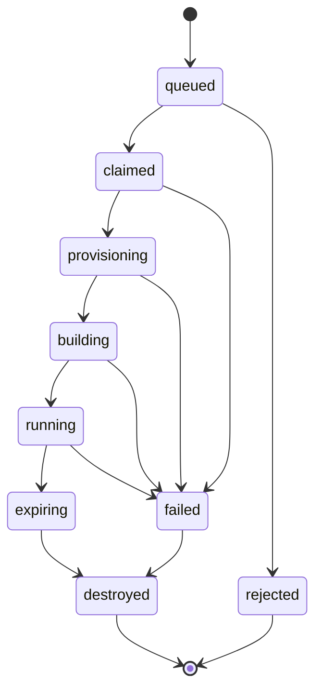

# Architecture

A build service that accepts a public GitHub repository, builds the Dockerfile at
its root, runs the resulting container, and reports live metrics for a fixed
lifespan before destroying everything it created.

The whole design follows from one fact: **the code it runs is written by someone
else.** Every structural decision below exists to contain that.

---

## The trust boundary

The system splits in two, and the split is the architecture:

- **Control plane** — code we wrote. Runs on Kubernetes. Holds credentials.
- **Data plane** — code strangers wrote. Runs in throwaway virtual machines.
  Holds nothing.

These must not share a kernel. A container is an isolated process on a shared
kernel, so a container escape lands the attacker on the host — and for the
control plane, that host is a Kubernetes node carrying cluster credentials. A
virtual machine has its own kernel, so escaping one means defeating the
hypervisor, which is a far harder problem.

This is also what hosted continuous integration providers do, for the same
reason.

Four layers nest on the control-plane side: host, then a virtual machine, then
pods, then containers. The data-plane machine has no pod layer at all — if a
stranger's container escapes, it lands inside a disposable virtual machine with
no inbound route and a timer running.

---

## Components

Only the dispatcher holds Proxmox credentials. Everything else is deliberately
powerless — that is a design constraint, not an accident of implementation.

| Component    | Responsibility                                                              | Privileges    |
| ------------ | --------------------------------------------------------------------------- | ------------- |
| Job API      | Accepts submissions, writes job records, exposes status and logs, serves the status page | None |
| Dispatcher   | Claims queued jobs, clones workers through the Proxmox API                  | Proxmox token |
| Reaper       | Destroys expired and orphaned virtual machines                              | Proxmox token |
| Bot          | Telegram client over long polling                                           | None          |
| Postgres     | Job records, the queue                                                      | —             |
| MinIO        | Logs and build artifacts                                                    | —             |
| Worker agent | Runs **inside** the ephemeral machine; clones, builds, runs, streams output | None          |

### Why the reaper is separate

If teardown lived inside the dispatcher, a dispatcher crash mid-job would leak a
virtual machine, and leaks accumulate until the host fills. The reaper runs
independently and works from the job records rather than from in-process state,
so it cleans up after a dispatcher that has died.

### Why the worker agent lives outside `apps/`

The agent ships into the untrusted machine. Kept beside the dispatcher in the
source tree, it could import the Proxmox client — and one careless import puts
credential-handling code inside the box running a stranger's build. Separating it
in the directory layout makes the trust boundary structural instead of something
a future commit has to remember.

---

## Job lifecycle

Every transition is a database write with a timestamp. That one decision buys
three things:

- **Metrics for free** — queue wait, build duration, teardown lag are all
  differences between stored timestamps.
- **A trivial reaper** — it queries for records sitting too long in a
  non-terminal state.
- **One source of truth** — the Job API, dispatcher and reaper all read the same
  record rather than keeping their own views.

The state machine lives in `packages/core` and is imported by all three, so the
legal transitions are defined once.

### Queue

Postgres with `SELECT ... FOR UPDATE SKIP LOCKED`. Sufficient at this scale and
one less service to run. Introduce Redis only when there is a measured reason.

---

## Worker lifecycle

1. **Golden template** — a minimal Linux image with Docker and the agent
   preinstalled, kept as a Proxmox template.
2. **Linked clone** — cloned per job, which takes seconds rather than minutes.
3. **Cloud-init** injects a one-time token and the job payload at boot.
4. **Callback** — the agent authenticates to the Job API with that token, which
   is valid for exactly one job, and receives the repository URL.
5. **Build and run** — clone, `docker build`, run, stream logs and metrics out.
6. **Destroy** — at time-to-live expiry, whether or not the job finished.

A machine that has executed untrusted code is **destroyed, never reused and never
reset.**

### Isolation constraints

Enforced on every worker:

- No inbound network. Nothing connects to it; it only calls out.
- Egress allowlist. Outbound traffic reaches a named set of hosts, not the
  internet and not the local network.
- Hard processor, memory and disk caps.
- A build timeout distinct from the time-to-live.
- A separate network segment with no route to the control plane or to anything
  else on the home network.
- Submission allowlist — who may submit at all.

### Threat model, stated plainly

A Dockerfile executes arbitrary commands at **build** time, not only at run time.
A container has network reach into the local network by default and does not need
to escape to cause harm. Opened to the public without the constraints above, the
realistic outcomes are crypto mining within days and the residential connection
used as an egress proxy for abuse.

The constraints are therefore not hardening applied at the end. They are the
feature.

---

## Build order

Each step is testable before the next one starts.

1. **Job API and Postgres**, with a fake dispatcher that sleeps and marks jobs
   done. Get the state machine right with no infrastructure involved.
2. **Real dispatcher** against Proxmox. Allowlisted to one submitter. No network
   restrictions yet.
3. **Reaper and teardown guarantees.** Kill the dispatcher mid-job deliberately
   and confirm nothing leaks.
4. **Network isolation** — segment, egress allowlist, quotas.
5. **Clients** — bot first, then the status page (static HTML served by the Job API).

Step 3 is the one that decides whether this is a real system. Test it by breaking
it on purpose.

---

## Deferred

- **Kata Containers** gives virtual-machine-level isolation behind ordinary
  Kubernetes pod semantics. A reasonable later replacement for the dispatcher
  plus Proxmox path. Not a starting point — it means learning two hard things at
  once.
- **Multi-node scheduling.** One node first; add nodes when the scheduler
  behaviour is the thing being learned.

---

## Appendix: glossary

### Machine layer

The hardest isolation boundary in the system lives here, which is why untrusted
builds get a whole machine rather than a container.

| Term                      | What it is                                                                                              |
| ------------------------- | ------------------------------------------------------------------------------------------------------- |
| Bare metal                | Physical hardware with nothing virtualised on top. The Proxmox box itself.                              |
| Hypervisor                | Software that divides one physical machine into several virtual ones. Proxmox is ours.                  |
| Virtual machine           | A simulated computer with its own kernel, memory and disk. Escaping one means defeating the hypervisor. |
| Node                      | In Kubernetes, any machine that runs workloads. Here, each node is itself a virtual machine on Proxmox. |
| Ephemeral virtual machine | One created for a single job and destroyed afterwards. Never reused, never reset.                       |

### Container layer

Containers share the host kernel, which makes them a weaker boundary than a
virtual machine and explains why they sit inside one here.

| Term          | What it is                                                                                                                  |
| ------------- | --------------------------------------------------------------------------------------------------------------------------- |
| Container     | An isolated process running on a shared kernel. Lighter than a virtual machine, and a weaker boundary.                      |
| Image         | The built, frozen filesystem a container starts from.                                                                       |
| Dockerfile    | The recipe for building an image. It executes commands at build time, so building a stranger's Dockerfile is itself a risk. |
| Docker daemon | The background service that builds images and runs containers on a machine.                                                 |

### Kubernetes control plane

Every object in the cluster lives in etcd and nowhere else, which makes it the
one component whose backups genuinely matter.

| Term               | What it is                                                                                                     |
| ------------------ | -------------------------------------------------------------------------------------------------------------- |
| kube-apiserver     | The single front door. Every tool, component and service talks to the cluster through it. Nothing bypasses it. |
| etcd               | The database holding every object in the cluster. Lose it and you have lost the cluster.                       |
| Scheduler          | Decides which node a new pod should run on. It records the decision; it does not start anything.               |
| controller-manager | Runs the loops comparing what exists against what you declared, and acts to close the gap.                     |
| kubelet            | The agent on each node that actually launches containers once a pod has been assigned there.                   |

Application data does not belong in etcd. That is why this system runs its own
Postgres.

### Workload objects

You declare a Deployment or a StatefulSet; Kubernetes creates everything below
it.

| Term        | What it is                                                                                                       |
| ----------- | ---------------------------------------------------------------------------------------------------------------- |
| Pod         | The smallest schedulable unit. Usually one container, sometimes several sharing a network address and lifecycle. |
| Replica     | One running copy of a pod.                                                                                       |
| ReplicaSet  | Keeps a stated number of identical pods alive. You rarely create one yourself.                                   |
| Deployment  | What you write for stateless services. Creates ReplicaSets and handles rollouts and rollbacks.                   |
| StatefulSet | The equivalent for workloads that own data. Stable names like `postgres-0`, each with its own volume.            |

A rollout is a second ReplicaSet scaling up as the first scales down. The old one
stays at zero replicas, which is why a rollback is instant.

### Storage

The claim outlives the pod. That is what lets `postgres-0` be deleted and come
back with its data intact.

| Term                  | What it is                                                                                         |
| --------------------- | -------------------------------------------------------------------------------------------------- |
| PersistentVolumeClaim | A request for storage: how much, and what kind. Written alongside the workload.                    |
| PersistentVolume      | The actual disk that satisfies a claim.                                                            |
| StorageClass          | Defines who provisions volumes and how, so claims are fulfilled automatically rather than by hand. |

### Networking

An Ingress with no Ingress controller installed does nothing, silently.

| Term               | What it is                                                                                                       |
| ------------------ | ---------------------------------------------------------------------------------------------------------------- |
| Service            | A stable address in front of a changing set of pods. Pods get new addresses constantly; this one does not move.  |
| Ingress            | A rule mapping a hostname and path to a Service. Only a rule, inert by itself.                                   |
| Ingress controller | The pod that reads those rules and routes incoming traffic. Typically nginx or Traefik.                          |
| Long polling       | The client opens an outbound connection and waits. Lets the bot receive messages with nothing connecting inward. |

The bot needs neither a Service nor an Ingress, because nothing ever connects to
it. The Job API, which serves the status page, needs both. The bot also runs at exactly one replica: two
pods polling the same Telegram token both receive updates and reply twice.

### Configuration

| Term      | What it is                                                                                                               |
| --------- | ------------------------------------------------------------------------------------------------------------------------ |
| Secret    | A Kubernetes object for sensitive values, mounted into pods. Base64-encoded by default, not encrypted unless configured. |
| ConfigMap | The same idea for non-sensitive settings.                                                                                |
| Namespace | A logical partition of the cluster, used to separate environments or tenants.                                            |

Worth knowing before the Proxmox token goes into a Secret: encryption at rest is
something you turn on, not something you get.

### Project components

| Term          | What it is                                                                                                           |
| ------------- | -------------------------------------------------------------------------------------------------------------------- |
| Job API       | Accepts submissions, writes job records, exposes status. Owns no infrastructure powers.                              |
| Dispatcher    | Claims queued jobs and calls Proxmox to create workers. The only component with Proxmox credentials.                 |
| Reaper        | Destroys expired or orphaned virtual machines. Separate from the dispatcher so a crash there does not leak machines. |
| Proxmox API   | The interface for creating, cloning and destroying virtual machines programmatically.                                |
| Metrics agent | The sidecar container watching the untrusted container and streaming its resource usage out.                         |
| MinIO         | Self-hosted object storage, used here for logs and build artifacts.                                                  |
| Time-to-live  | The lifespan granted to a worker, after which it is destroyed whether or not the job finished.                       |
